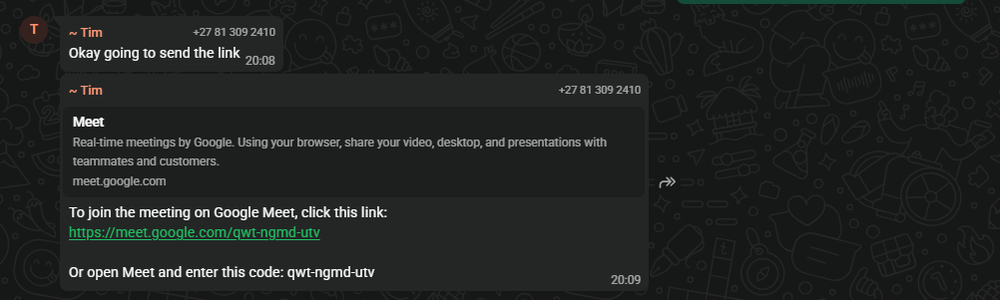
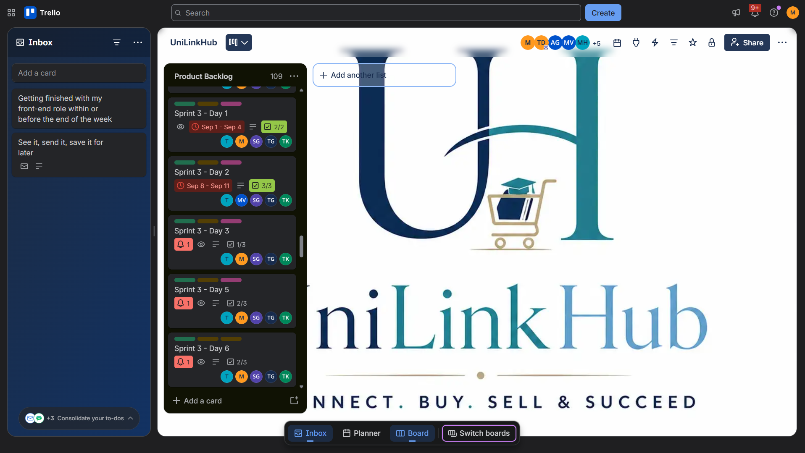
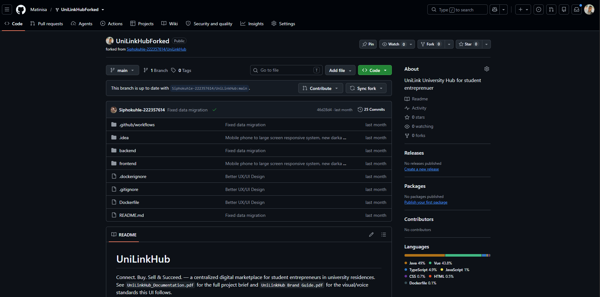

# 1\. Agile Team Charter — UniLink Hub

## 1.1 Project Purpose

UniLink Hub was proposed as a marketplace that connects student entrepreneurs with other students who are looking for products or services. The team identified that students sometimes struggle to discover student-owned businesses because information is shared across informal group chats and different online platforms. The purpose of UniLink Hub is to make student businesses and their offerings easier to discover by bringing them together in one accessible platform.

## 1.2 Shared Goal

The team's shared goal was to build and present a usable student marketplace where:

-   Student entrepreneurs can create business profiles and advertise their products or services.
-   Other students can browse and search for available products and services.
-   Users can filter offerings and view listing details.
-   Potential customers can contact or express interest in student entrepreneurs.

## 1.3 Team Roles and Responsibilities

| Role / Responsibility | Assigned Work |
| --- | --- |
| Backend Development | Matinisa Lubisi and Andani Gola — responsible for Java/Spring Boot backend development, Spring Security, REST APIs, registration and authentication functionality, and backend integration. |
| Database Design | Tim Davids — responsible for database design, drafting the Entity Relationship Diagram (ERD), and testing the database using MySQL Workbench. |
| UI/UX Design | Tshepiso Pretty Kekana — responsible for designing the website wireframes and interface prototypes using Figma. |
| Frontend Development | Siphokuhle Gedze — responsible for frontend development using React, HTML, CSS and JavaScript. |
| Documentation | Tshepiso Pretty Kekana and Tim Davids — responsible for preparing project documentation. |
| Project Management / Coordination | Tim Davids — responsible for coordinating project activities and tasks. |
| Testing | All team members — responsible for testing their respective contributions and assisting with overall system testing. |

## 1.4 Stakeholders and Users

-   **Student client:** Registers on the platform, browses and searches for student products or services, views listing details, and contacts or expresses interest in providers.
-   **Student entrepreneur:** Creates an entrepreneur or business profile, publishes product or service listings, adds information such as prices, images and location, and manages listings.
-   **Administrator:** Responsible for reviewing or verifying registrations and business providers or clients, depending on the functionality implemented in the system.
-   **Lecturer:** Reviews project progress, provides feedback, and assesses the project during presentations.
-   **Project team:** Responsible for developing, integrating, testing, documenting, and presenting the system.

## 1.5 Working Agreements and Tools

The team used several tools to support communication, collaboration and project development:

-   **Microsoft Teams:** Used for team meetings and discussions. WhatsApp was used as an alternative when technical problems affected Teams.
-   **GitHub:** Used to share source code, manage commits and collaborate on development.
-   **Trello:** Used to allocate tasks and monitor project progress.
-   **Figma:** Used to create interface wireframes and prototypes.
-   **Postman:** Used to test backend REST API endpoints.

The team also participated in progress presentations with the lecturer. However, internal communication and meetings were not always consistent throughout the project.

## 1.6 Boundaries and Collaboration Challenges

The project was divided into different areas of responsibility, including frontend development, backend development, database design, documentation and project coordination.

My primary responsibility was backend development, including working with Java, Spring Boot, Spring Security, REST APIs, registration and authentication, and database connectivity and testing. Other team members handled frontend development, UI/UX design, database design, documentation and coordination.

One of the challenges we experienced was inconsistent communication, whre meetings did not always take place weekly, and obtaining progress updates, documentation and deployment information sometimes took longer than expected.

We also experienced occasional technical problems with our communication tools. When Microsoft Teams was unavailable or experienced difficulties, we sometimes switched to WhatsApp to continue communicating.These challenges demonstrated the importance of consistent communication, clear task ownership and regular progress updates in an Agile team.

## 1.7 Evidence to Attach

The following screenshots provide evidence of the tools and communication methods used during the development of UniLink Hub.

### Evidence 1.1: Team Communication

**Figure 1.1: Microsoft Teams Meeting**

**Purpose:** This screenshot provides evidence of team communication and collaboration during the development of UniLink Hub.

**Reflection:** Team meetings helped us share progress, discuss challenges and coordinate our responsibilities. They also demonstrated the importance of communication when different team members were working on the frontend, backend, database and documentation.

### Evidence 1.2: Trello Board

**Figure 1.2: Trello Board**

**Purpose:** This screenshot provides evidence of how Trello was used to allocate tasks and monitor project progress.

**Reflection:** Trello helped the team track the progress of assigned tasks. Team members could mark completed tasks on the board, allowing everyone to see which activities had been completed without always needing to ask for updates through meetings or messages. This improved task visibility and helped the team monitor individual contributions.

### Evidence 1.3: GitHub Repository

**Figure 1.3: GitHub Repository**

**Purpose:** This screenshot provides evidence of the team's use of GitHub as a collaborative development environment for sharing source code and managing project contributions.

**Reflection:** GitHub helped us collaborate on the system's source code without having to share entire project folders manually. It also provided a way to track code changes and review contributions through commits and other repository activities. This demonstrated the value of version control when multiple developers work on the same project.

## 1.8 Personal Reflection

Working as part of the UniLink Hub team helped me understand that software development involves more than technical implementation. Effective teamwork also requires clear task ownership, consistent communication, collaboration and the timely sharing of information. My responsibility for backend development gave me practical experience working with Java, Spring Boot, Spring Security, REST APIs, registration and authentication functionality, and database connectivity and testing.

One challenge I experienced was understanding and troubleshooting unfamiliar backend behaviour, particularly when working with API responses, security configuration and database connectivity. I sometimes relied on tutorials and AI assistance to understand errors and identify possible solutions. Although these resources helped me continue with development, I recognised that I still need more practice solving programming problems independently and explaining the implementation decisions behind my code.

Another lesson I learned was that inconsistent team communication can affect development progress and integration. When updates or information are delayed, it becomes more difficult for team members to coordinate their work and identify problems early. In future projects, I would encourage more consistent communication, document important decisions, raise blockers earlier, and maintain regular progress updates. I would also aim to improve my independent problem-solving skills so that I can approach technical challenges with greater confidence.

Overall, the project helped me understand the importance of collaboration, accountability, and continuous learning when working in an Agile software development environment.
