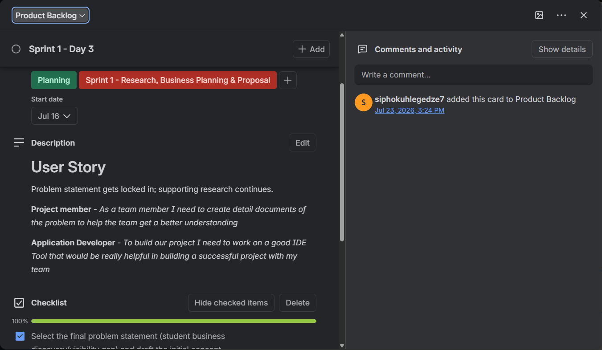
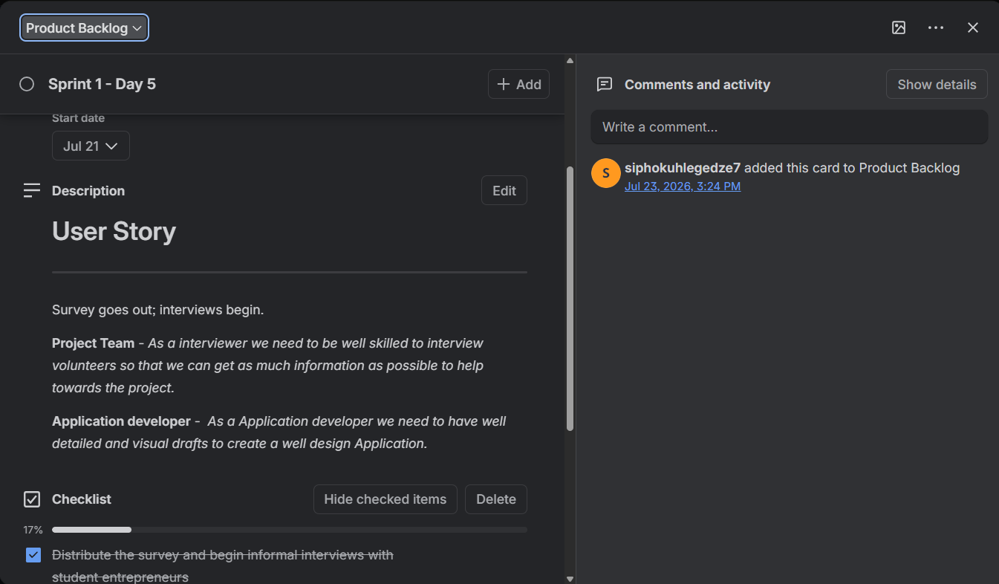
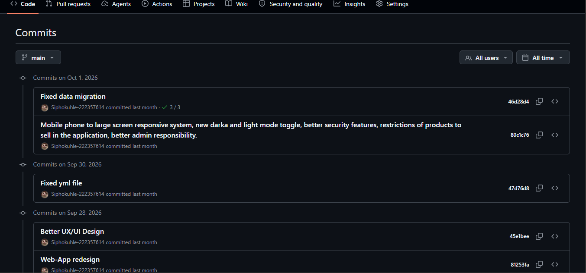
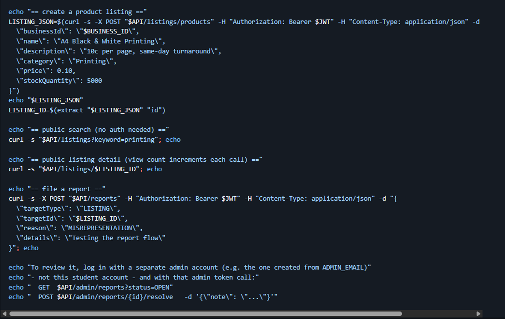

# 2\. User Stories and Tasks — UniLink Hub

## 2.1 Requirements Background

The team identified a need for students to discover products and services offered by student entrepreneurs more easily. Requirements were gathered through team discussions, interviews and group-chat messages about the difficulties students experienced when trying to find student-owned businesses and their offerings.

The user stories presented below were reconstructed from the functionality and requirements described for the UniLink Hub project. They represent the user needs that guided the system's development. Not every story should automatically be interpreted as a completed feature.

## 2.2 User Stories and Acceptance Criteria

| ID | User Story | Priority | Acceptance Criteria |
| --- | --- | --- | --- |
| US-01 | As a student, I want to register for an account so that I can use the marketplace. | High | The system accepts valid registration details, validates required fields and provides an appropriate response when registration succeeds or fails. |
| US-02 | As a student browsing the marketplace, I want to search or filter listings so that I can find relevant products or services. | High | Users can search or filter available listings and view results relevant to their search criteria. |
| US-03 | As a student, I want to view a listing's details, price, location and images so that I can decide whether it meets my needs. | High | The listing displays its available details, including its description, price, location and images where provided. |
| US-04 | As a student entrepreneur, I want to create a business profile so that other students can discover my business. | High | An entrepreneur can submit the required business information and create a profile that can be displayed on the marketplace. |
| US-05 | As a student entrepreneur, I want to add products or services with prices, images and locations so that students understand what I offer. | High | An entrepreneur can submit listing information, and successfully saved listings display the available product or service details. |
| US-06 | As an entrepreneur, I want to edit or delete my own listings so that I can keep information up to date. | Medium | An entrepreneur can update or delete their own listings, and unauthorised users cannot modify another entrepreneur's listings. |
| US-07 | As a student, I want to contact or express interest in a provider so that I can ask about a product or service. | High | The platform provides an available contact or interest option through which a student can communicate their interest in a listing. |
| US-08 | As an entrepreneur, I want to receive a notification when a student expresses interest so that I can respond. | Medium | An entrepreneur receives an appropriate notification when a student expresses interest, where this functionality is implemented. |
| US-09 | As an administrator, I want to review or verify registrations and business providers so that marketplace participation can be checked. | Medium | An administrator can access the relevant review functionality and manage registration or provider verification according to their permissions. |
| US-10 | As a student, I want to edit my profile so that my account information remains current. | Medium | A student can update permitted profile information, and the changes are saved and displayed correctly. |
| US-11 | As a user, I want to choose a light or dark appearance so that the interface is comfortable to use. | Low / Improvement | If implemented, users can switch between light and dark appearance modes. Otherwise, this remains a proposed improvement. |

## 2.3 My Individual Tasks: Backend and Database

My primary responsibility in the project was backend development and database connectivity. The following tasks describe the work I contributed to:

-   Implementing backend functionality using Java and Spring Boot.
-   Working with Spring Security and registration and authentication behaviour.
-   Creating and connecting REST API endpoints to support frontend functionality.
-   Testing registration and API behaviour using Postman.
-   Testing database connectivity using MySQL.
-   Testing password encryption and hashing behaviour.
-   Troubleshooting backend security configuration and API response issues.
-   Supporting integration between the backend and frontend.

## 2.4 Task Decomposition Example

**User Story User no.                        01: Register an Account**

The registration user story can be divided into smaller development tasks:

1.  Identify the required registration fields.
2.  Create or connect the registration API endpoint.
3.  Validate the registration request.
4.  Apply the appropriate password-protection mechanism.
5.  Save the account information through the persistence layer.
6.  Test successful and unsuccessful registration requests using Postman.
7.  Record the observed results and resolve any issues identified during testing.

## 2.5 Evidence

The following screenshots provide evidence of the requirements, development activities and backend testing associated with UniLink Hub.

### Evidence 2.5.1: User Stories

**Figure 2.1: User Stories on Trello**

**Purpose:** These screenshots provide evidence of the user stories recorded for UniLink Hub and how user requirements were organised during the project.

**Reflection:** User stories helped us understand what users expected from the system and the problems we were trying to solve. Writing requirements from the user's perspective encouraged us to consider the purpose of each feature rather than focusing only on the technical implementation. This helped connect the development work to the actual needs of students and student entrepreneurs.

### Evidence 2.5.2: GitHub Commits

**Figure 2.2: GitHub Repository Commits**

**Purpose:** This screenshot provides evidence of development activity and code contributions recorded in the team's GitHub repository.

**Reflection:** GitHub helped us share and manage the project's source code. The commit history also provided a way to track changes made to the application and identify development contributions. Through this experience, I gained a better understanding of the importance of version control when working with other developers on a shared project.

### Evidence 2.5.3: API Testing

**Figure 2.3: Backend API Endpoint Testing**

**Purpose:** These screenshots provide evidence of backend API testing using Postman. The tests were used to check server-side functionality, inspect API responses and test relevant CRUD operations.

**Reflection:** Using Postman made it easier to send requests to backend endpoints and inspect the responses returned by the server. It helped me identify problems with API requests and understand whether the backend was responding as expected. I also learned that successful API testing involves checking more than whether an endpoint responds; it is important to examine the response data, status codes and expected behaviour.

## 2.6 Personal Reflection

Working with user stories helped me understand how software requirements can be translated into practical development activities. Instead of treating a feature as an isolated piece of code, I learned to consider the problem it is intended to solve for the user. Breaking user stories into smaller tasks also made it easier to understand the development work required to implement a feature. This was particularly useful in my backend role, where functionality involved several connected components, including API endpoints, validation, security configuration and database operations.

One of the most important lessons I learned was that an API endpoint is not complete simply because the code compiles. The request, security rules, database operation and response must work together correctly for the functionality to meet its intended purpose. I also gained practical experience using Postman to test backend endpoints and investigate unexpected responses. However, I recognised that I need to improve my ability to define clear acceptance criteria and consistently document test results so that other team members can verify whether a task has been completed successfully.

In future projects, I would pay more attention to documenting requirements, breaking larger user stories into manageable tasks and recording evidence as development progresses. This would improve collaboration, make progress easier to monitor and help ensure that the final system addresses the needs of its intended users.
