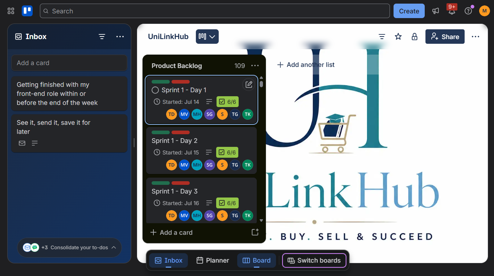

# 3\. Product Backlog — UniLink Hub

## 3.1 Purpose

The product backlog is the ordered list of work needed to build and improve UniLink Hub. The priorities below are a reconstructed summary based on the described project scope, not a claim that these were the exact original Trello rankings. Replace this table with an export or screenshot of the actual backlog if available.

Priority meanings:

-   **High:** central to the marketplace's main purpose or needed for the core flow.
-   **Medium:** important supporting capability.
-   **Low / future:** improvement that can follow the core flow.

## 3.2 Backlog items

| Order | Backlog item | Priority | Status based on current recollection | Evidence / note |
| --: | --- | --- | --- | --- |
| 1 | Account registration and email verification | High | Implemented in some form; verify final end-to-end status | Attach registration/email verification evidence and API tests. |
| 2 | Authentication and access/security controls | High | Backend work implemented/tested; verify complete role behaviour | Attach safe Postman/API evidence and relevant code/commits. |
| 3 | Student marketplace browsing | High | Developed as part of the frontend | Attach a screenshot of the real application without dummy data. |
| 4 | Search and filtering of listings | High | Described as a project feature; verify final working behaviour | Attach a search/filter test or screenshot. |
| 5 | Business/entrepreneur profile creation | High | Developed as part of the marketplace flow; verify final status | Attach a real profile-creation flow or code evidence. |
| 6 | Product/service listing creation and details | High | Developed; image handling and final listing behaviour should be checked | Attach a real listing and create/edit evidence. |
| 7 | Listing management (edit/delete) | Medium | Described in project scope; verify final permissions and behaviour | Attach a safe test showing owner access restrictions. |
| 8 | Provider contact / expression of interest | High | Contact information and interest flow described; verify exact completed scope | Attach a real working flow. |
| 9 | Entrepreneur interest notifications | Medium | Notification panel/interaction described; verify end-to-end behaviour | Attach a screenshot or test result. |
| 10 | Administrator review/verification | Medium | Described as part of the system; verify final implementation | Attach admin flow and role-permission evidence. |
| 11 | Integration and system testing | High | Testing was performed by an assigned team member; exact test results need confirmation | Attach actual test cases/results if available. |
| 12 | Deployment and final demonstration | High | Deployment was attempted/completed for presentation, but the app is currently not accessible online | Confirm the URL and status with the teammate responsible for deployment. |
| 13 | Light/dark theme preference | Low / future | Not confirmed as completed | Record as a future improvement unless the running system proves it works. |
| 14 | Improve team progress and documentation tracking | Medium / process improvement | Improvement identified from collaboration challenges | Use clearer meeting notes, task owners, due dates and evidence links in future. |

## 3.3 How the backlog was managed

The team used Trello to track some tasks and backlog work, and GitHub for code sharing through branches and commits. Work was divided across frontend/UI, backend/database, documentation and coordination. The project also included progress presentations to the lecturer, which provided opportunities to review progress and discuss improvements.

## 3.4 Evidence to attach

[Click here to view our Trello product backlog](https://trello.com/b/B01lSyH6/unilinkhub)

### Evidence 3.1: Product Backlog

**Figure 1: Product backlog**

**Purpose:** Product backlog assisted us the most on tracking the number 
of days each sprint is suppose to take

**Reflection:** Using product backlog when working with IT project, it faccilitates 
the technical development process

## 3.5 Reflection

A prioritised backlog helps a team focus on the features that deliver the most important user value first. UniLink Hub’s core value depends on students being able to discover offerings and entrepreneurs being able to publish them, so registration, browsing and listing workflows are central. The experience also showed me that a backlog is useful only when its status is current and clear. In future, I would update task status regularly, link tasks to commits and tests, and clearly label incomplete features before the final demonstration.
